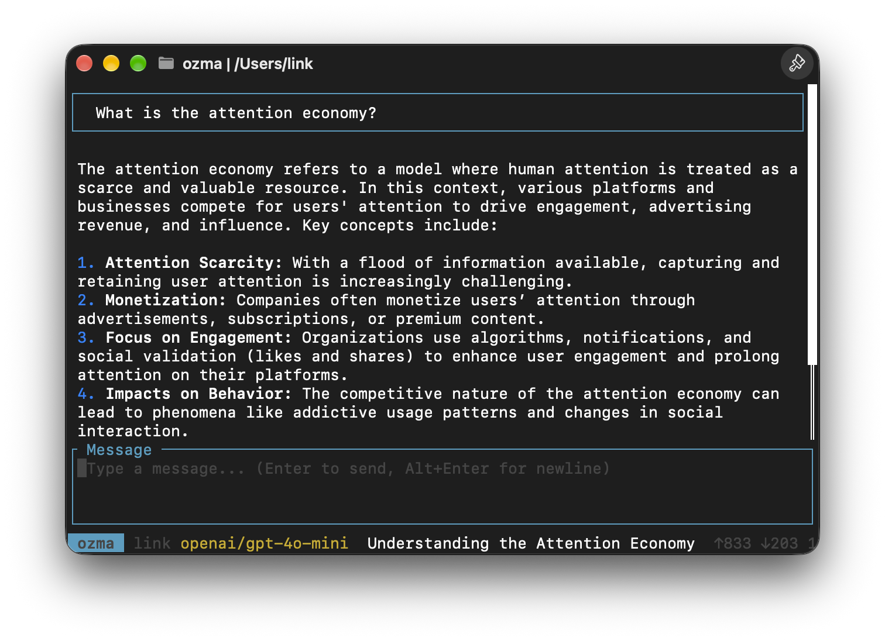

# ozma

A terminal-based LLM chat client built with Rust.



ozma provides a keyboard-driven TUI for conversing with large language models, with support for multiple providers, personas, multimodal input, tool use, MCP servers, session persistence, and context compaction.

## Features

- **Multi-provider LLM support** -- OpenAI, Anthropic, Gemini, and any OpenAI-compatible endpoint (e.g. Ollama) via [genai](https://crates.io/crates/genai)
- **ACP agents** -- use external coding agents (e.g. OpenCode) over the [Agent Client Protocol](https://agentclientprotocol.com/) as an alternate source alongside direct providers
- **Multiple models per provider** -- list all available models, switch at runtime via the command palette
- **Personas** -- built-in modes (`ozma`, `ozcode`, `ozreview`, `ozplan`) that shape the system prompt; switch with `Ctrl+.`
- **Streaming responses** -- tokens appear as they arrive
- **Multimodal input** -- paste images from the clipboard (`Ctrl+V`), attach images or inline text files with `@path` (with tab completion)
- **Built-in tools** -- file I/O, directory listing, shell commands, web fetch, web search
- **MCP support** -- connect to external [Model Context Protocol](https://modelcontextprotocol.io/) servers (stdio and HTTP transports)
- **Tool permission system** -- auto-approve read-only tools, prompt for destructive/dangerous ones
- **Session persistence** -- conversations saved to SQLite (including provider, model, params, and persona); browse and resume past sessions
- **Context compaction** -- summarize older messages to stay within context limits
- **Usage & cost** -- token counts, context-window percentage, and estimated session cost from [models.dev](https://models.dev)
- **Model parameters** -- set temperature, top_p, and max_tokens per provider (defaults) or per session
- **Export** -- write conversations to Markdown or JSON, or copy either format to the clipboard
- **Markdown rendering** -- assistant responses rendered as formatted markdown in the terminal, with inline images where the terminal supports them
- **Command palette** -- quick access to all commands via `Ctrl+P`

## Requirements

- Rust 2024 edition (1.85+)
- An API key for at least one LLM provider (e.g. `GEMINI_API_KEY`, `OPENAI_API_KEY`, `ANTHROPIC_API_KEY`)

## Installation

```sh
git clone https://github.com/subpop/ozma.git
cd ozma
cargo build --release
# binary at ./target/release/ozma
```

Optional CLI flags:

```sh
ozma --tick-rate 4 --frame-rate 30
```

## File Locations

ozma uses platform-native directories via the [dirs](https://crates.io/crates/dirs) crate:

| | Linux | macOS | Windows |
|---|---|---|---|
| Config | `~/.config/ozma/config.toml` | `~/Library/Application Support/ozma/config.toml` | `%APPDATA%\ozma\config.toml` |
| Database | `~/.local/share/ozma/ozma.db` | `~/Library/Application Support/ozma/ozma.db` | `%APPDATA%\ozma\ozma.db` |
| Log | `~/.local/share/ozma/ozma.log` | `~/Library/Application Support/ozma/ozma.log` | `%APPDATA%\ozma\ozma.log` |
| Pricing cache | `~/.local/share/ozma/cache/models.json` | `~/Library/Application Support/ozma/cache/models.json` | `%APPDATA%\ozma\cache\models.json` |

`$XDG_CONFIG_HOME` and `$XDG_DATA_HOME` are respected on Linux.

Provider and model choice are stored per conversation in the database (not a separate state file).

## Configuration

ozma loads its config from `config.toml` (see paths above). If the file doesn't exist, it defaults to Gemini with `gemini-2.5-flash`.

```toml
# Choose which source to use by default (provider or agent name)
default_source = "openai"

# Optional default persona: "ozma", "ozcode", "ozreview", or "ozplan"
default_persona = "ozma"

# Providers ---------------------------------------------------------------
# `adapter` is optional. When set, it acts as a shorthand for the provider's
# base values: the default wire format, endpoint, and API key env var.
# Explicit `wire_protocol`, `base_url`, and `api_key_env`/`api_key_cmd`
# values take precedence over the adapter defaults.
# When `adapter` is omitted, the provider must be fully defined:
# `base_url`, `api_key_env` or `api_key_cmd`, and a concrete `wire_protocol`
# (`chat_completions`, `responses`, or `messages`; "auto" is not allowed
# without an adapter).
# `models` is optional: if omitted, ozma will try to discover models from the provider API.

[[provider]]
name = "openai"
adapter = "openai"
models = ["gpt-4o-mini", "gpt-4o", "o3-mini"]
# api_key_env = "OPENAI_API_KEY"  # genai auto-detects this
# api_key_cmd = "op read op://vault/openai/credential"  # alternative to api_key_env:
# run a shell command to fetch the key on every request (e.g. from a password
# manager). Setting both api_key_env and api_key_cmd for the same provider is
# a config error.
# additional_headers = { "x-my-header" = "value" }
# temperature = 0.7
# top_p = 1.0
# max_tokens = 4096

[[provider]]
name = "anthropic"
adapter = "anthropic"
models = ["claude-sonnet-4-20250514", "claude-opus-4-20250514", "claude-haiku-4-20250514"]

[[provider]]
name = "gemini"
adapter = "gemini"
# models omitted -> auto-discover

[[provider]]
name = "local-ollama"
adapter = "openai"
models = ["llama3"]
base_url = "http://localhost:11434/v1/"

# A provider without `adapter` must be fully defined: base_url, an API key,
# and a concrete wire_protocol. Useful for custom gateways when no genai
# adapter matches.
[[provider]]
name = "my-gateway"
base_url = "https://gateway.example.com/v1/"
api_key_env = "GATEWAY_API_KEY"
wire_protocol = "chat_completions"
# api_key_cmd = "op read op://vault/gateway/credential"  # alternative to api_key_env
# models omitted -> auto-discover

[[provider]]
name = "opencode-go"
adapter = "opencode_go"
# Optional: override protocol for endpoints that support multiple wire formats.
# Supported values: "auto", "chat_completions", "responses", "messages"
# wire_protocol = "responses"
# When a conversation is active, ozma sends x-opencode-session automatically.
# base_url = "https://ai.gateway.go/"
# models omitted -> auto-discover

# If your gateway mixes protocols across models, define separate providers
# with different wire_protocol values.

# ACP agents --------------------------------------------------------------
# When an agent is the active source, ozma talks to it over JSON-RPC stdio.
# The agent owns the LLM loop, tools, and MCP. Sessions come from the agent
# (Ctrl+O), not ozma.db. MCP servers below are handed to the agent on session/new.

[[agent]]
name = "opencode"
command = "opencode"
args = ["acp"]
# cwd = "."           # optional; defaults to process cwd
# env = { FOO = "bar" }

# Tool permissions ---------------------------------------------------------

[tools]
auto_approve_read = true     # read_file, list_directory, web_fetch, web_search
auto_approve_write = false   # write_file
auto_approve_execute = false # run_command

# MCP servers --------------------------------------------------------------

[[mcp_servers]]
name = "filesystem"
transport = "stdio"
command = "npx"
args = ["-y", "@modelcontextprotocol/server-filesystem", "/tmp"]

[[mcp_servers]]
name = "remote"
transport = "http"
url = "http://localhost:3000/mcp"
```

### ACP agents

Set `default_source` to an `[[agent]]` name (or pick the agent in the model/source picker) to chat through that agent. Direct `[[provider]]` sessions continue to use ozma’s built-in tools, in-process MCP, and SQLite persistence.

Manual smoke checklist (requires an ACP-capable binary such as `opencode`):

1. Configure `[[agent]]` + `default_source = "opencode"` (or switch via the picker).
2. Start ozma — agent initialize + `session/new` should succeed (see log).
3. Send a message — reply streams in the same chat UI.
4. Trigger a tool that needs permission — y/n/a prompt appears; approve/deny works.
5. `Ctrl+O` lists agent sessions; Enter loads one; `Ctrl+N` creates a new agent session.
6. Switch back to a genai provider — sessions come from ozma.db again; local tools/MCP apply.

### Personas

| Name | Role |
|------|------|
| `ozma` | General-purpose assistant |
| `ozcode` | Coding-focused |
| `ozreview` | Code review |
| `ozplan` | Planning and architecture |

Each persona sets its own system prompt. Environment context (cwd, platform, date, git branch) is appended automatically.

## Keyboard Shortcuts

### General

| Key | Action |
|-----|--------|
| `Ctrl+P` | Open command palette |
| `Ctrl+N` | New session |
| `Ctrl+O` | Open session list |
| `Ctrl+K` | Compact context |
| `Ctrl+M` | Switch model |
| `Ctrl+.` | Switch persona |
| `Ctrl+C` | Copy selected message or code block |
| `Ctrl+E` / `e` | Expand/collapse inlined file blocks |
| `Esc` `Esc` | Cancel streaming / tool execution / compaction |
| `Ctrl+Q` | Quit |

### Input

| Key | Action |
|-----|--------|
| `Enter` | Send message |
| `Alt+Enter` / `Shift+Enter` | Insert newline |
| `Ctrl+V` | Paste image from clipboard (or text if no image) |
| `@path` + `Tab` | Attach an image or inline a text file |
| `Esc` | Clear input (or dismiss `@` completion) |
| `Up` / `Down` | Message history (when on first/last line) |
| `PageUp` / `PageDown` | Scroll conversation |

Mouse wheel scrolls the conversation; click a message or code block to select it for `Ctrl+C`.

### Tool Permission Prompt

| Key | Action |
|-----|--------|
| `y` / `Enter` | Approve |
| `n` / `Esc` | Deny |
| `a` | Approve all pending |

### Command Palette

Open with `Ctrl+P`. Includes session management, model/persona switching, parameter overrides (`temperature`, `top_p`, `max_tokens`), export to Markdown/JSON (file or clipboard), scrolling, and quit.

## Built-in Tools

| Tool | Permission | Description |
|------|-----------|-------------|
| `read_file` | Read-only | Read file contents |
| `write_file` | Destructive | Write/create files |
| `list_directory` | Read-only | List directory entries |
| `run_command` | Dangerous | Execute shell commands |
| `web_fetch` | Read-only | Fetch a URL |
| `web_search` | Read-only | Search the web |

## Architecture

ozma follows an Elm-like **Event -> Action -> Update -> Render** cycle:

```
Terminal Events (crossterm)
        |
        v
   Event Stream (tui.rs)
        |
        v
   handle_event() -> Action
        |
        v
   update(Action) -- mutate state
        |
        v
   render(Frame) -- draw UI
```

Key crates: [ratatui](https://crates.io/crates/ratatui) for rendering, [crossterm](https://crates.io/crates/crossterm) for terminal I/O, [tokio](https://crates.io/crates/tokio) for async, [genai](https://crates.io/crates/genai) for LLM calls, [rmcp](https://crates.io/crates/rmcp) for MCP, [rusqlite](https://crates.io/crates/rusqlite) for persistence.

## License

GPL 3.0
