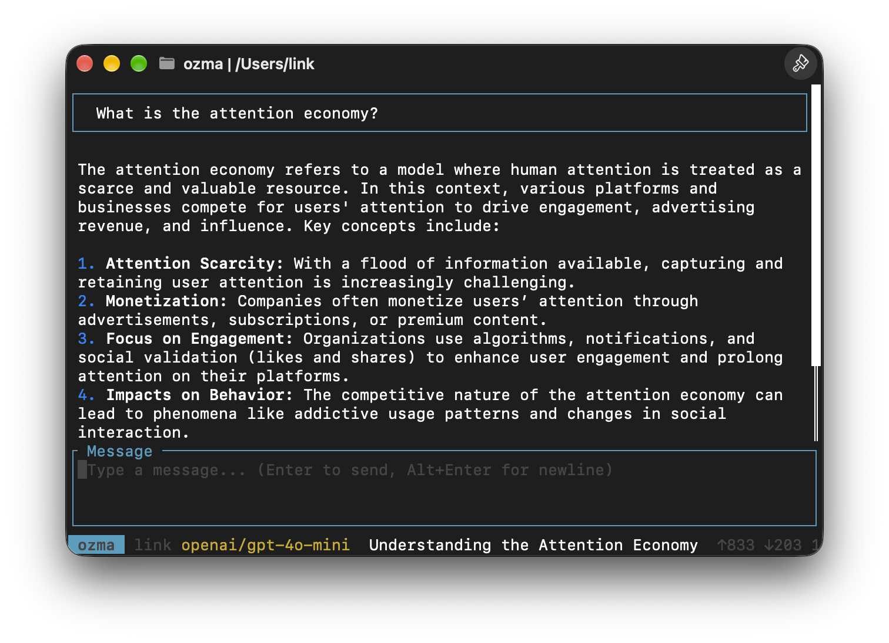

# ozma

A terminal-based LLM chat client built with Rust.



ozma provides a keyboard-driven TUI for conversing with large language models, with support for multiple providers, personas, multimodal input, tool use, MCP servers, session persistence, and context compaction.

## Features

- **Multi-provider LLM support** -- OpenAI, Anthropic, Gemini, and any OpenAI-compatible endpoint (e.g. Ollama) via [genai](https://crates.io/crates/genai)
- **ACP agents** -- use external coding agents (e.g. OpenCode) over the [Agent Client Protocol](https://agentclientprotocol.com/) as an alternate source alongside direct providers
- **Multiple models per provider** -- list all available models, switch at runtime via the command palette
- **Personas** -- built-in modes (`ozma`, `ozcode`, `ozreview`, `ozplan`) plus user-defined personas from config; switch with `Ctrl+.`
- **Streaming responses** -- tokens appear as they arrive
- **Multimodal input** -- paste images from the clipboard (`Ctrl+V`), attach images or inline text files with `@path` (with tab completion)
- **Built-in tools** -- file I/O, directory listing, shell commands, web fetch, web search
- **MCP support** -- connect to external [Model Context Protocol](https://modelcontextprotocol.io/) servers (stdio and HTTP transports); stderr from stdio servers is captured and viewable with `Ctrl+L`
- **Tool permission system** -- auto-approve read-only tools, prompt for destructive/dangerous ones
- **Session persistence** -- conversations saved to SQLite (including provider, model, params, and persona); browse and resume past sessions
- **Context compaction** -- summarize older messages to stay within context limits
- **Usage & cost** -- token counts, context-window percentage, and estimated session cost from [models.dev](https://models.dev)
- **Model parameters** -- set temperature, top_p, and max_tokens per provider (defaults) or per session
- **Export** -- write conversations to Markdown or JSON, or copy either format to the clipboard
- **Markdown rendering** -- assistant responses rendered as formatted markdown in the terminal, with inline images where the terminal supports them
- **Command palette** -- quick access to all commands via `Ctrl+P`

## Requirements

- Rust 2024 edition (1.85+)
- An API key for at least one LLM provider (e.g. `GEMINI_API_KEY`, `OPENAI_API_KEY`, `ANTHROPIC_API_KEY`)

## Installation

```sh
git clone https://github.com/subpop/ozma.git
cd ozma
cargo build --release
# binary at ./target/release/ozma
```

Optional CLI flags:

```sh
ozma --tick-rate 4 --frame-rate 30
```

## File Locations

ozma uses platform-native directories via the [dirs](https://crates.io/crates/dirs) crate:

| | Linux | macOS | Windows |
|---|---|---|---|
| Config | `~/.config/ozma/config.json` | `~/Library/Application Support/ozma/config.json` | `%APPDATA%\ozma\config.json` |
| Database | `~/.local/share/ozma/ozma.db` | `~/Library/Application Support/ozma/ozma.db` | `%APPDATA%\ozma\ozma.db` |
| Log | `~/.local/share/ozma/ozma.log` | `~/Library/Application Support/ozma/ozma.log` | `%APPDATA%\ozma\ozma.log` |
| Pricing cache | `~/.local/share/ozma/cache/models.json` | `~/Library/Application Support/ozma/cache/models.json` | `%APPDATA%\ozma\cache\models.json` |

`$XDG_CONFIG_HOME` and `$XDG_DATA_HOME` are respected on Linux.

Provider and model choice are stored per conversation in the database (not a separate state file).

## Configuration

ozma loads its base config from `config.json` (see paths above). If that file doesn't exist, it defaults to Gemini with `gemini-2.5-flash`.

A JSON Schema is available at `docs/config.schema.json` (published at `https://subpop.github.io/ozma/config.schema.json`). You can opt into editor validation/autocomplete by adding `"$schema"` to your config.

If a `.ozma.json` file exists in the current working directory when you start ozma, it is layered on top of the user config and overrides matching keys. (Objects merge by key; arrays like `mcp_servers` append to the base list.)

Providers are configured as an object map, where each key is the provider name.
Set `default_model` to explicitly choose the provider's startup model; if omitted, ozma uses the first model in `models` (or the first discovered model when `models` is omitted).

Example local override (`./.ozma.json`):

```json
{
  "$schema": "https://subpop.github.io/ozma/config.schema.json",
  "default_source": "anthropic",
  "tools": {
    "auto_approve_write": true
  },
  "mcp_servers": [
    {
      "name": "repo-files",
      "transport": "stdio",
      "command": "npx",
      "args": ["-y", "@modelcontextprotocol/server-filesystem", "."]
    }
  ]
}
```

User-level base config example (`config.json`):

```json
{
  "$schema": "https://subpop.github.io/ozma/config.schema.json",
  "default_source": "openai",
  "default_persona": "ozma",
  "personas": {
    "ops": {
      "description": "Operations/SRE",
      "system_prompt": "You are an operations assistant. Prioritize reliability, incident response, and clear runbooks."
    }
  },
  "provider": {
    "openai": {
      "adapter": "openai",
      "models": ["gpt-4o-mini", "gpt-4o", "o3-mini"],
      "default_model": "gpt-4o"
    },
    "anthropic": {
      "adapter": "anthropic",
      "models": ["claude-sonnet-4-20250514", "claude-opus-4-20250514", "claude-haiku-4-20250514"]
    },
    "gemini": {
      "adapter": "gemini"
    },
    "local-ollama": {
      "adapter": "openai",
      "models": ["llama3"],
      "base_url": "http://localhost:11434/v1/"
    },
    "my-gateway": {
      "base_url": "https://gateway.example.com/v1/",
      "api_key_env": "GATEWAY_API_KEY",
      "wire_protocol": "chat_completions"
    },
    "opencode-go": {
      "adapter": "opencode_go"
    }
  },
  "agent": {
    "opencode": {
      "command": "opencode",
      "args": ["acp"]
    }
  },
  "tools": {
    "auto_approve_read": true,
    "auto_approve_write": false,
    "auto_approve_execute": false
  },
  "mcp_servers": [
    {
      "name": "filesystem",
      "transport": "stdio",
      "command": "npx",
      "args": ["-y", "@modelcontextprotocol/server-filesystem", "/tmp"]
    },
    {
      "name": "remote",
      "transport": "http",
      "url": "http://localhost:3000/mcp"
    }
  ]
}
```

### ACP agents

Set `default_source` to an agent `name` (or pick the agent in the model/source picker) to chat through that agent. Direct provider sessions continue to use ozma’s built-in tools, in-process MCP, and SQLite persistence.

Manual smoke checklist (requires an ACP-capable binary such as `opencode`):

1. Configure an `agent` map entry (e.g. `"agent": { "opencode": { ... } }`) + `"default_source": "opencode"` (or switch via the picker).
2. Start ozma — agent initialize + `session/new` should succeed (see log).
3. Send a message — reply streams in the same chat UI.
4. Trigger a tool that needs permission — y/n/a prompt appears; approve/deny works.
5. `Ctrl+O` lists agent sessions; Enter loads one; `Ctrl+N` creates a new agent session.
6. Switch back to a genai provider — sessions come from ozma.db again; local tools/MCP apply.

### Personas

Built-in personas:

| Name | Role |
|------|------|
| `ozma` | General-purpose assistant |
| `ozcode` | Coding-focused |
| `ozreview` | Code review |
| `ozplan` | Planning and architecture |

You can define additional personas in config under `personas`:

```json
{
  "default_persona": "ops",
  "personas": {
    "ops": {
      "description": "Operations/SRE",
      "system_prompt": "You are an operations assistant. Focus on reliability and incident response."
    }
  }
}
```

Each persona sets its own system prompt. Environment context (cwd, platform, date, git branch) is appended automatically.

## Keyboard Shortcuts

### General

| Key | Action |
|-----|--------|
| `Ctrl+P` | Open command palette |
| `Ctrl+N` | New session |
| `Ctrl+O` | Open session list |
| `Ctrl+K` | Compact context |
| `Ctrl+L` | Open MCP server log (captured stderr) |
| `Ctrl+M` | Switch model |
| `Ctrl+.` | Switch persona |
| `Ctrl+C` | Copy selected message or code block |
| `Ctrl+E` / `e` | Expand/collapse inlined file blocks |
| `Esc` `Esc` | Cancel streaming / tool execution / compaction |
| `Ctrl+Q` | Quit |

### Input

| Key | Action |
|-----|--------|
| `Enter` | Send message |
| `Alt+Enter` / `Shift+Enter` | Insert newline |
| `Ctrl+V` | Paste image from clipboard (or text if no image) |
| `@path` + `Tab` | Attach an image or inline a text file |
| `Esc` | Clear input (or dismiss `@` completion) |
| `Up` / `Down` | Move cursor (wraps visually); message history at top/bottom edge |
| `PageUp` / `PageDown` | Scroll conversation |

Mouse wheel scrolls the conversation; click a message or code block to select it for `Ctrl+C`.

### Tool Permission Prompt

| Key | Action |
|-----|--------|
| `y` / `Enter` | Approve |
| `n` / `Esc` | Deny |
| `a` | Approve all pending |

### Command Palette

Open with `Ctrl+P`. Includes session management, model/persona switching, parameter overrides (`temperature`, `top_p`, `max_tokens`), export to Markdown/JSON (file or clipboard), scrolling, and quit.

## Built-in Tools

| Tool | Permission | Description |
|------|-----------|-------------|
| `read_file` | Read-only | Read file contents |
| `write_file` | Destructive | Write/create files |
| `list_directory` | Read-only | List directory entries |
| `run_command` | Dangerous | Execute shell commands |
| `web_fetch` | Read-only | Fetch a URL |
| `web_search` | Read-only | Search the web |

## Architecture

ozma follows an Elm-like **Event -> Action -> Update -> Render** cycle:

```
Terminal Events (crossterm)
        |
        v
   Event Stream (tui.rs)
        |
        v
   handle_event() -> Action
        |
        v
   update(Action) -- mutate state
        |
        v
   render(Frame) -- draw UI
```

Key crates: [ratatui](https://crates.io/crates/ratatui) for rendering, [crossterm](https://crates.io/crates/crossterm) for terminal I/O, [tokio](https://crates.io/crates/tokio) for async, [genai](https://crates.io/crates/genai) for LLM calls, [rmcp](https://crates.io/crates/rmcp) for MCP, [rusqlite](https://crates.io/crates/rusqlite) for persistence.

## License

GPL 3.0
